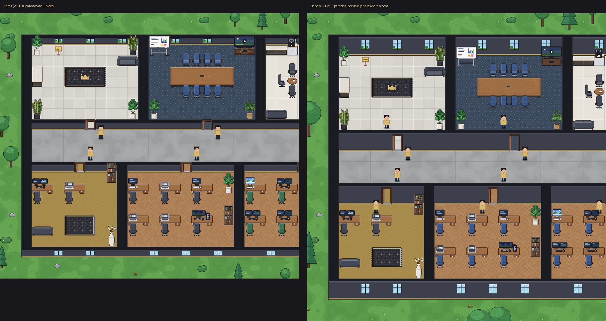
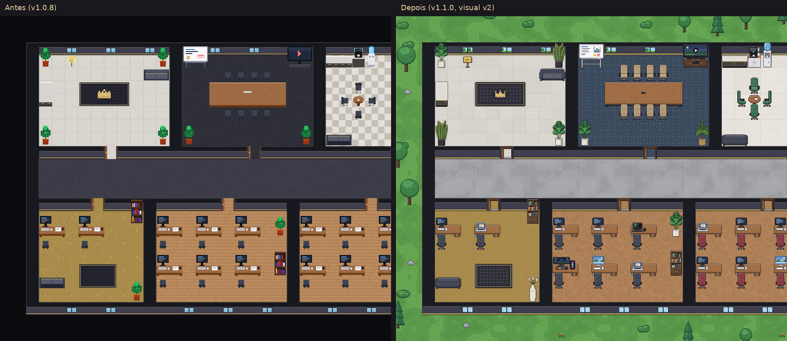

# Changelog

As versões seguem `MAJOR.MINOR.PATCH`. Cada versão publicada tem os instaladores e as notas em
[Releases](https://github.com/marcelolucas11/office-imp/releases).

## 1.2.0 — 15/11/2026 — Paredes altas

As paredes eram finas demais para o tamanho do boneco: o personagem ficava maior que a porta e os
objetos encostados na parede passavam por cima dela. Agora paredes, portas e janelas têm a escala
do avatar.

- **Paredes de 2 blocos de altura.** A face da parede (a parte de frente) ocupa 2 fileiras: o boneco
  tem cerca de 3/4 da altura da parede, e geladeira, estante, quadro branco e TV ficam encostados
  nela em vez de passar por cima. Os cantos e os trechos verticais continuam como topo de parede.
- **Portas de 2 blocos.** O vão da porta atravessa a parede inteira, com verga por cima no
  acabamento da parede; o boneco passa por ela com folga. Fechada, a porta bloqueia o vão todo; dá
  para abrir e fechar dos dois lados (X perto dela).
- **Janelas altas**, com mais céu na vista, travessa e peitoril. Todos os acabamentos (ardósia,
  escura, lisa, tijolo, madeira e vidro) foram adaptados.
- **Árvores maiores** no exterior, na escala do prédio (2 a 3 vezes a altura de uma pessoa).
- Ao entrar numa sala privada, o recorte claro pega a parede alta inteira.

### Antes de atualizar

- **Mapas salvos:** nenhum passo manual. Ao carregar, o servidor atualiza o mapa sozinho: cada
  parede com face ganha uma fileira, e tudo o que fica abaixo dela desce junto (mesas, áreas,
  spawns, portas). Por isso o mapa fica algumas fileiras mais alto. Objetos de parede (relógio,
  split, neon…) ficam na fileira de cima da face. A versão atualizada passa a ser a salva na
  próxima publicação pelo Mapmaker. A ala nova de uma expansão já sai com paredes altas.
- **Posições salvas:** quem estava numa posição que virou parede volta para a entrada.
- **Mapmaker:** uma parede desenhada com 1 fileira continua aparecendo fina (como antes). Para a
  parede alta, desenhe 2 fileiras.

## 1.1.0 — 14/11/2026 — Visual v2

A arte do cenário e dos objetos foi refeita com mais detalhe, mais objetos e mais variações, e o
avatar ganhou mais opções. A mudança é **só estética**: grade, colisão, áreas, mesas, permissões e
tempo real continuam como eram, e mapas e avatares já salvos continuam válidos.

### Antes de atualizar

- **Banco de dados:** esta versão inclui a migração `0001_desk_look.sql` (uma coluna nova,
  `desks.look`). Ela é **aplicada sozinha quando o servidor inicia**; não há nada a rodar à mão.
  A atualização pelo painel (Painel do ADM → Atualizações → **Atualizar servidor**) já faz o backup
  do banco antes.
- **Clientes antigos:** quem estiver com o app ou a aba numa versão anterior continua entrando
  normalmente, mas vê os avatares sem os acessórios novos e as mesas sem a cor e o setup escolhidos
  pelos ocupantes, até atualizar. Depois de atualizar o servidor, use **Atualizar todos agora**.
- **Mapas e avatares salvos:** nenhum passo manual. Os escritórios existentes abrem com a arte nova
  nos mesmos lugares, e um avatar já salvo é desenhado pixel a pixel como antes.

### Cenário

- Pisos, paredes e todos os objetos redesenhados em 32 px com traço de 1 px e contorno.
- **Pisos novos:** porcelanato, cimento queimado, espinha de peixe, carpete com padrão e grama
  sintética (15 no total). **Paredes novas:** lisa clara, tijolo aparente, painel de madeira e
  divisória de vidro (7 no total). Janelas com vista para fora.
- **Exterior:** grama, árvores, arbustos, flores e pedras em volta do escritório. A câmera agora
  anda alguns blocos além da borda do mapa para mostrar o lado de fora (colisão e movimento não
  mudam).
- **Dia e noite** pelo horário do fuso do escritório: amanhecer, dia, entardecer e noite, com
  estrelas e lua à noite.
- Os escritórios novos criados pelo assistente já saem com os pisos novos, plantas variadas, setups
  variados nas mesas e uma cor de cadeira por sala. Os escritórios existentes não são alterados.

### Objetos

- **Mesas de trabalho:** reta, de 3 blocos, em L, standing desk, de vidro, de madeira escura, gamer
  e bancada compartilhada.
- **Cadeiras e assentos:** de escritório, gamer, executiva de couro, banqueta, poltrona e pufe.
- **Setup da mesa** (o que fica em cima): monitor, PC gamer com ultrawide, dois monitores, notebook
  prata, all-in-one, notebook e vazio.
- **Objetos de mesa:** teclado mecânico, mousepad, mouse, caneca, garrafa, fone, luminária,
  porta-retrato, post-its, livros, troféu, suculenta e cacto.
- **Extras:** cafeteira expresso, microfone de podcast, ring light, impressora, máquina de snacks,
  aquário, quadro de cortiça, relógio de parede com a hora do escritório, letreiro neon com texto
  editável e ar-condicionado split.
- **Plantas:** costela-de-adão, espada-de-são-jorge, mandacaru, suculentas, palmeira, vaso alto,
  samambaia pendurada e jardim vertical.
- O restante do catálogo (sofá, estante, armário, copa, tapetes, porta, portal, quadro branco, TV,
  quiosque, fliperama, pôster, placa, mesas de reunião e balcão) foi redesenhado no mesmo estilo.

### Cores e mesa de cada pessoa

- Cada objeto aparece **uma vez** na paleta; a **aba "Cor"** (Mapmaker e Build Tool) mostra as
  variantes dele. Nas mesas, a mesma aba tem o **Setup**.
- Cada pessoa escolhe a **cor e o setup da própria mesa** em ⋯ → Minha mesa → Decorar, sem alterar
  o mapa publicado. **"Deixar o posto"** (antes "Liberar esta mesa") devolve a mesa ao padrão.
- Objetos de parede (cortiça, relógio, neon, split, samambaia e jardim vertical) só podem ser
  colocados na face de uma parede.

### Avatar

- O boneco continua o mesmo (formato, tamanho e animação). Novas opções: **acessórios com seleção
  múltipla** (3 óculos, boné, chapéu, fones, headset gamer, gravata, relógio, brinco e crachá
  Impera), **16 cores por peça**, 15 cabelos, barba e bigode, tipo de roupa de cima e de baixo,
  estampa e calçado. Editor novo, com abas e prévia nas 4 direções.

### Animações de contexto

- Telas dos monitores, RGB do PC gamer e do teclado, vapor do café, peixes do aquário, ponteiros do
  relógio, neon, plantas perto do split, árvores e nuvens na vista das janelas. São trocas de
  quadros prontos, pausadas fora da tela e com a aba oculta.
- Opção **"Reduzir animações do cenário"** nas configurações (por padrão segue a preferência de
  movimento reduzido do sistema).

### Correções desta versão

- Zoom com a roda do mouse: um passo dado durante a transição não é mais ignorado.
- Gravata com a cor igual à da roupa não some mais (ela escurece ou clareia um tom).
- Escritório pequeno em tela grande: as árvores cobrem toda a área visível, em vez de sobrar só grama.

Detalhes técnicos, guias por fase e problemas conhecidos: [docs/visual-v2/PROGRESS.md](docs/visual-v2/PROGRESS.md).

## 1.0.0 a 1.0.8

Primeiras versões: escritório virtual com vídeo por proximidade, Mapmaker, Build Tool, painel do
ADM, notas de reunião, rádio, agenda e apps de desktop. O histórico está nas notas de cada
[release](https://github.com/marcelolucas11/office-imp/releases).
