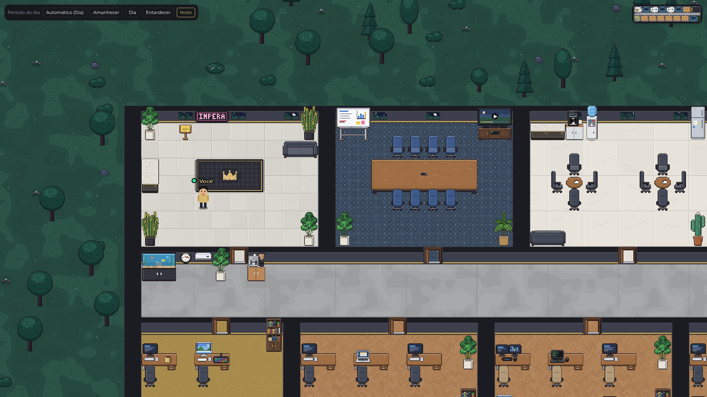
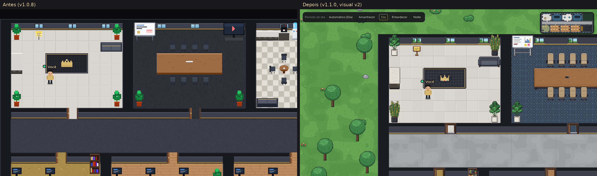
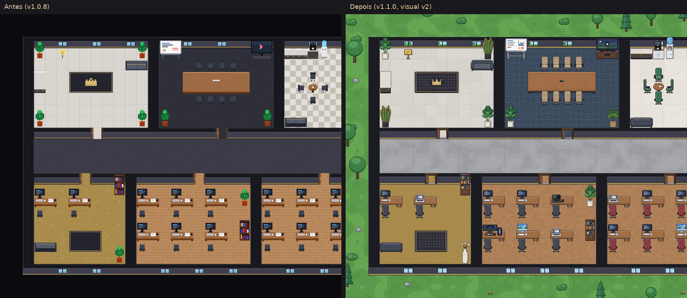
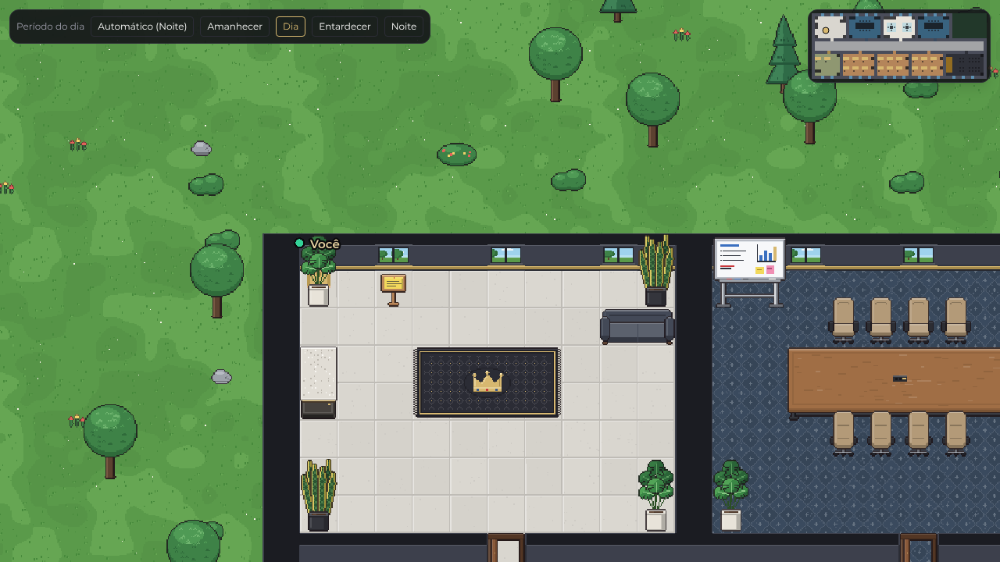
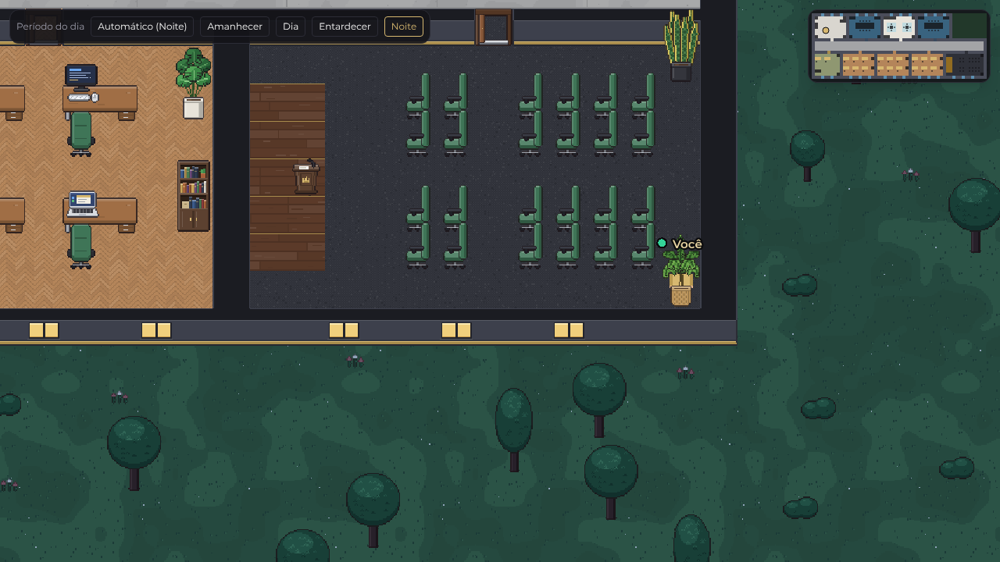

# office-imp

Escritório virtual **open source** com vídeo por proximidade, no estilo do Gather 1.0: um mapa 2D em
pixel art, cada pessoa com o seu avatar, e o áudio e o vídeo ligam sozinhos quando duas pessoas se
aproximam. Roda no seu próprio servidor (uma VPS comum) e tem app para **Mac (Apple Silicon e Intel)**
e **Windows**, além do navegador.

[](https://github.com/marcelolucas11/office-imp/releases/latest/download/Office-Impera-Mac.dmg)
[](https://github.com/marcelolucas11/office-imp/releases/latest/download/Office-Impera-Windows.exe)

> Interface em português do Brasil. Licença [AGPL-3.0](LICENSE). Marcas: veja [TRADEMARKS.md](TRADEMARKS.md).



## O que tem

| Área | Recursos |
|---|---|
| **Mapa e avatar** | Movimento por setas, WASD ou clique duplo (com desvio de obstáculos), tecla **X** para interagir, seguir e liderar pessoas, mini-mapa, exterior com grama e árvores, **dia e noite** pelo fuso do escritório, avatar com acessórios múltiplos e 16 cores por peça |
| **Áudio e vídeo** | Conexão por proximidade (raio de 2 blocos de fábrica; só a administração aumenta, até 10; volume cai com a distância), **área de conversa em cada mesa** (a câmera liga ao chegar), **salas privadas** isoladas de verdade, palco (**Spotlight**) que fala para todos, compartilhamento de tela por várias pessoas, **controles por pessoa** no vídeo e na tela (volume e silenciar só para você, ocultar o vídeo para você, e qualquer pessoa da conversa desliga o microfone, a câmera ou a tela de outra para todos), entrada sempre com o microfone mudo, Visualização Simplificada e **Modo Mini** (só as câmeras flutuando, sem moldura; sozinho ou com todas as câmeras desligadas vira ícones pequenos com os bonecos, que se arrasta para qualquer canto, aumenta ou diminui pelas bordas e some em "Não incomodar"; no app desktop entra sozinho ao minimizar ou trocar de app, e o ícone na barra de menus tem a chave para ligar ou desligar isso) |
| **Status** | Disponível, Ocupado e **Não incomodar** (⌘/Ctrl + O / I / U), Ausente (manual), status personalizado com emoji |
| **Comunicação** | Chat (perto de mim, todos, direta), reações, aceno, levantar a mão, lista de participantes, perfil |
| **Mesas** | Cada pessoa tem a sua mesa, escolhe a **cor e o setup** dela (monitor, PC gamer, notebook…), decora com a Build Tool e recebe recados e presentes mesmo offline |
| **Construção** | **Mapmaker** completo (15 pisos, 7 paredes, 69 objetos com 274 variantes de cor na aba "Cor", áreas, portais, versões) e objetos interativos: quadro branco colaborativo, site, TV, pôster, jogo e placa |
| **Escritórios prontos** | Assistente cria o escritório para 1–10, 11–21 ou N pessoas, pergunta quantos sócios e se dividem a sala; **expansão** com aprovação quando a equipe cresce |
| **Painel do ADM** | Em tempo real: horas online e ativas, tempo em cada status, tempo em call e com quem; linha do tempo por pessoa; CSV |
| **Notas de reunião** | Áudio (sem vídeo) transcrito no próprio servidor com Whisper, com o nome de quem falou; cópia no painel e por e-mail |
| **Rádio** | Ouvir junto YouTube e YouTube Music, com fila, DJ e volume que baixa sozinho durante conversas |
| **Agenda** | Google Calendar: eventos do dia, entrar na sala pelo link e agendar reunião |
| **Acesso** | Contas criadas só pela administração (usuário e senha, **sem e-mail**), 2FA para Donos e Admins, link de convite da equipe e de convidado (com ou sem validade) |
| **Atualizações** | Botão para atualizar o servidor, "atualizar todos agora" e atualização automática ao abrir |

Papéis: **Dono**, **Admin**, **Funcionário** e **Convidado**. A tabela completa está em [docs/ADMIN.md](docs/ADMIN.md).

## Visual v2 (versão 1.1.0)

A arte do cenário e dos objetos foi refeita em pixel art de 32 px com traço de 1 px. A mudança é só
estética: os mapas e os avatares já salvos continuam valendo, sem migração manual.





- **Cenário:** pisos e paredes novos (porcelanato, cimento queimado, espinha de peixe, tijolo,
  painel de madeira, divisória de vidro), janelas com vista, **exterior com grama e árvores** e
  **dia e noite** pelo horário do fuso do escritório.
- **Objetos:** 8 mesas de trabalho, 6 assentos, 7 setups de mesa (do notebook ao PC gamer), objetos
  de mesa, plantas, copa, aquário, letreiro neon com texto editável, relógio com a hora do
  escritório e mais. Cada objeto aparece uma vez na paleta e tem as cores na **aba "Cor"**.
- **Mesa de cada pessoa:** cor e setup escolhidos pelo ocupante; "Deixar o posto" devolve ao padrão.
- **Avatar:** mesmo boneco, com acessórios múltiplos, 16 cores por peça, mais cabelos, barba,
  roupas, estampas e calçados.
- **Animações de contexto:** telas, RGB, vapor do café, peixes, neon, árvores e nuvens, com a opção
  "Reduzir animações".

| Dia | Noite |
|---|---|
|  |  |

Mais prints (escritórios de 7, 15 e 40 pessoas, antes e depois, Mapmaker e Build Tool) em
[docs/visual-v2/prints](docs/visual-v2/prints); o que mudou em cada versão está no
[CHANGELOG.md](CHANGELOG.md).

## Instalação rápida (VPS com Ubuntu ou Debian)

```bash
curl -fsSL https://raw.githubusercontent.com/marcelolucas11/office-imp/main/infra/install.sh | sudo bash
```

O instalador coloca tudo em `/opt/office-imp`, em um projeto Docker separado, e **não toca** em
containers, serviços ou proxies que já existem na máquina. No final ele mostra os dois registros de
DNS que você precisa criar e o endereço e o token da configuração inicial.
Passo a passo completo (DNS, HTTPS, SMTP, Google Calendar, app do Mac): [docs/INSTALL.md](docs/INSTALL.md).

## App para Mac e Windows

[](https://github.com/marcelolucas11/office-imp/releases/latest/download/Office-Impera-Mac.dmg)
[](https://github.com/marcelolucas11/office-imp/releases/latest/download/Office-Impera-Windows.exe)

Os botões sempre baixam a versão mais recente.

- **Mac** (M1 em diante e Intel): abra o arquivo baixado e arraste o **Office Impera** para a pasta
  **Aplicativos**. Na primeira abertura o macOS bloqueia o app, porque ele não tem a assinatura paga
  da Apple: vá em **Ajustes do Sistema → Privacidade e Segurança**, role até o fim e clique em
  **Abrir Mesmo Assim**. Isso só é pedido uma vez.
- **Windows**: abra o arquivo baixado. Ele instala e abre sozinho, sem perguntas. Se o Windows avisar
  "editor desconhecido", clique em **Mais informações → Executar assim mesmo**.

O app já abre conectado ao servidor definido em [`apps/desktop/branding.json`](apps/desktop/branding.json)
e dá para trocar o endereço em Ajuda → Trocar servidor.

## Como é feito

```
apps/web       cliente (React, Vite, Tailwind, Phaser 3, LiveKit, Excalidraw)
apps/server    API (Fastify) + tempo real (Colyseus) + tarefas (BullMQ) + banco (PostgreSQL, Drizzle)
apps/desktop   app desktop (Electron) para Mac e Windows
apps/updater   serviço mínimo que atualiza as imagens Docker pelo painel
packages/shared      tipos, permissões, proximidade e regras usadas pelos dois lados
packages/map-engine  gerador de escritórios e expansão
packages/ui          componentes visuais
infra/         Docker Compose de produção, instalador, backup, exemplos de proxy
e2e/           testes de ponta a ponta (Playwright, três pessoas simultâneas)
```

Serviços em produção: `app`, `postgres`, `redis`, `livekit` (áudio e vídeo), `egress` (gravação de
áudio), `whisper` (transcrição) e `updater`. Detalhes em [docs/ARCHITECTURE.md](docs/ARCHITECTURE.md).

## Desenvolvimento

```bash
pnpm install
docker compose -f infra/docker-compose.dev.yml up -d   # Redis + LiveKit
pnpm dev                                               # http://localhost:5173
pnpm lint && pnpm typecheck && pnpm test               # verificações
pnpm build && pnpm e2e                                 # ponta a ponta
```

Veja [CONTRIBUTING.md](CONTRIBUTING.md).

## Documentação

- [docs/INSTALL.md](docs/INSTALL.md) — instalar, configurar DNS/HTTPS, SMTP, Google Calendar, apps, backup
- [docs/ADMIN.md](docs/ADMIN.md) — guia do Painel do ADM e das permissões
- [docs/ARCHITECTURE.md](docs/ARCHITECTURE.md) — como as peças se encaixam
- [docs/DECISIONS.md](docs/DECISIONS.md) — decisões técnicas e alternativas descartadas
- [docs/PROGRESS.md](docs/PROGRESS.md) — o que está pronto, o que foi verificado e pendências
- [CHANGELOG.md](CHANGELOG.md) — o que mudou em cada versão e as notas de atualização
- [docs/visual-v2/PROGRESS.md](docs/visual-v2/PROGRESS.md) — o visual v2: guias por fase, medições e problemas conhecidos
- [SECURITY.md](SECURITY.md) · [TRADEMARKS.md](TRADEMARKS.md) · [assets/LICENSES.md](assets/LICENSES.md)

## Licença

Código sob [GNU AGPL-3.0](LICENSE): quem oferecer uma versão modificada como serviço precisa publicar
o código-fonte dela. O nome e o logotipo da Impera não fazem parte da licença
([TRADEMARKS.md](TRADEMARKS.md)).
